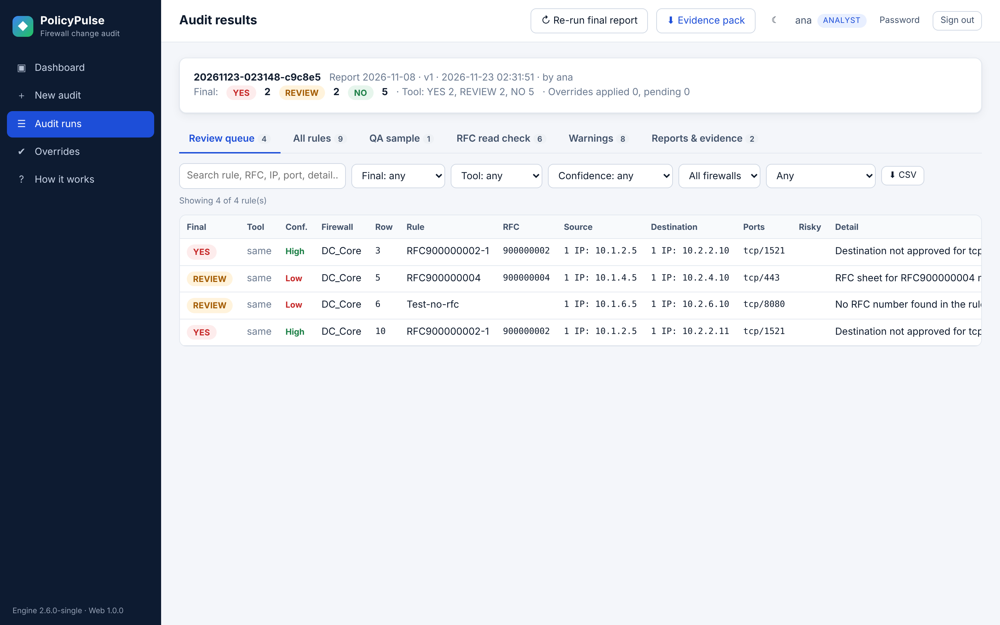
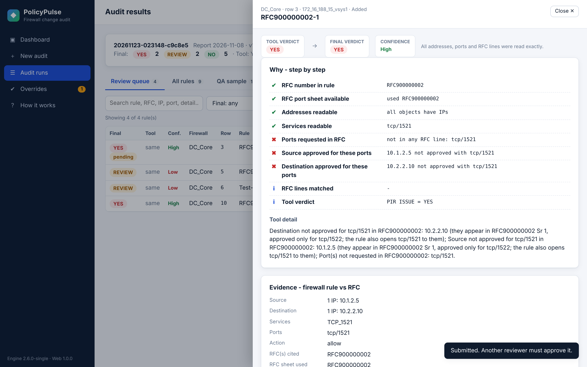
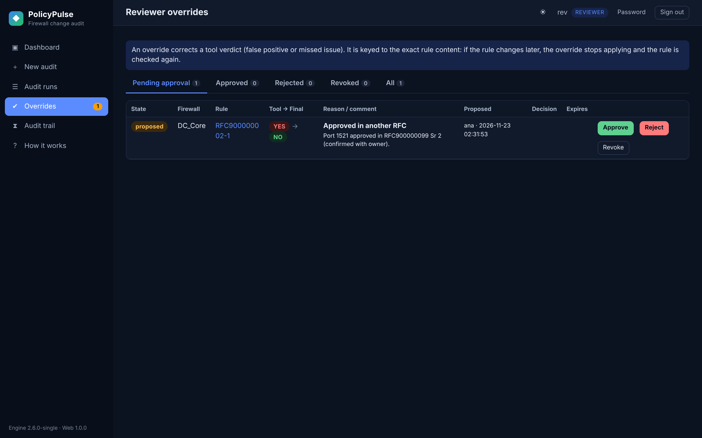
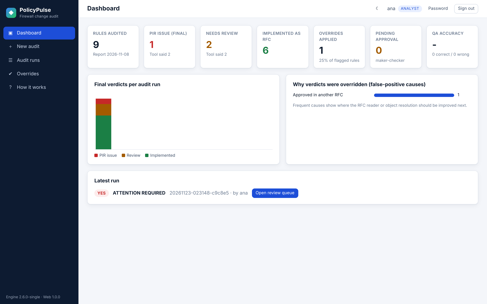

# PolicyPulse — firewall change audit (fwaudit)

PolicyPulse checks every firewall rule change in the AlgoSec *Changes Summary* reports against the approved RFC port sheets. For each rule it says whether the change was implemented as approved (PIR ISSUE = NO), opens something that was not approved (YES), or could not be verified (REVIEW).

* **Pure Python 3.8+ standard library.** No pip installs and no internet access.
* `fwaudit.py` is the audit engine, desktop window and command line. It never opens a network connection, and its selftest checks this.
* `fwaudit_web.py` + `fwaudit_web_ui.py` provide the web front end. Run it on your own PC (localhost) or on an intranet server for a team.

| Review queue | Rule evidence and explanation |
|---|---|
|  |  |
| **Maker-checker approvals (dark theme)** | **Dashboard** |
|  |  |

## Download (always the latest tested build)

Every push to GitHub runs the tests on Windows and Linux (Python 3.8 and 3.12). If they pass, it builds two downloads and puts them on the **[latest release page](../../releases/tag/latest)**:

* **PolicyPulse-&lt;version&gt;-&lt;commit&gt;.zip**: the .py files plus double-click start files `1_Desktop_window.bat`, `2_Web_version.bat` and `3_Selftest.bat`. Needs Python 3.8+.
* **PolicyPulse-windows-exe-&lt;commit&gt;.zip**: `fwaudit.exe` and `PolicyPulse-web.exe`. No Python needed.

`VERSION.txt` inside the ZIP shows the commit, the build date and the SHA-256 of every file, so a tester always knows which build they have. Each run's files also stay under **Actions → the run → Artifacts** for 30 days. To build the ZIP yourself, run `python tools/make_package.py`.

## Quick start

```bash
python fwaudit.py selftest
```

```bash
python fwaudit.py run --algosec ALGOSEC_DIR --rfc RFC_DIR --out OUT_DIR
```

```bash
python fwaudit.py
```

```bash
python fwaudit_web.py
```

These commands, in order:
1. Run the built-in check. It must print `SELFTEST PASSED`.
2. Run an audit from the command line.
3. Open the desktop window.
4. Start the web front end at http://127.0.0.1:8765. On the first start it asks you to create an admin account.

### Web front end on an intranet server

```bash
python fwaudit_web.py --host 0.0.0.0 --port 8443 --cert server.pem --key server.key
```

```bash
python fwaudit_web.py adduser priya --role reviewer
```

Roles: **viewer** (read only) < **analyst** (upload, run, propose overrides, QA) < **reviewer** (approve or reject other people's overrides) < **admin** (users).

Keep it on the internal network. Firewall rules and RFCs are sensitive.

## What's new in 2.6

### 1. RFC sheets with merged cells and unusual layouts
* Header cells merged across columns or rows are now detected. Examples: "Source" spanning five columns, or "Sr. No." spanning two rows.
* Header synonyms are accepted: *Source Details, Src, Destination Details, Dest, Target, IP Address, Port No., Protocol …*
* Headers can be one row ("Source IP | Destination IP | Port") or a group header with **one or two** sub-header rows.
* **Every visible sheet** with a port table is read (DC + DR tabs, for example). Sheets named like *Sample / Instructions / Guideline / Read me* are skipped.
* If the Sr. No. column is blank or missing, rows are numbered automatically.
* IPv6 addresses are **flagged** as "not checked" instead of being silently dropped.
* **Manual templates** cover layouts the auto-detection can't read. Add them to `fwaudit_config.json`:

```json
{"rfc": {"templates": [
  {"name": "OldForm", "file_regex": "", "sheet": "Port",
   "header_row": 5, "data_start": 6,
   "columns": {"sr": "A", "src_ip": "C", "dst_ip": "G", "port": "J",
               "ptype": "K", "src_owner": "D", "dst_owner": "H"}}]}}
```

* The **RFC read check** (web) and the log list the sheets read, the layout found, the line count and each warning for every RFC. Nothing is lost silently.
* Set `"read_all_sheets": false` to go back to the old behaviour of reading only the first sheet with a port table.

### 2. False positives: overrides and the final report
* A reviewer can correct a verdict by choosing the final PIR ISSUE, a **reason** and **evidence**.
* **Maker-checker:** a different reviewer must approve the override before it is used (`review.require_approval`).
* Overrides are keyed to a **fingerprint of the rule content**:
  * Tomorrow's identical rule is cleared automatically.
  * If the rule changes, the override stops applying and the rule is checked again.
* An optional expiry date suits temporary acceptances.
* The final workbook keeps both values: the **Tool verdict** and the **Final verdict**. It also adds Confidence, Override reason and Approved-by columns, plus a **Reviewer Overrides** sheet. The overrides file is part of the chain of custody.
* Overrides can be made from the web UI or the desktop window (right-click a rule → *Override Verdict*). On the command line, `--overrides FILE` or `--no-overrides`.

### 3. Trust: is the tool right?
* **Confidence** for every verdict (High / Medium / Low), with the reason. For example: *"Port Type blank, TCP assumed"* or *"address object without an IP"*.
* **Explanation, step by step:** RFC found → sheet read → addresses readable → ports requested → source and destination approved for those ports.
* **Evidence view:** the rule's IPs and ports next to every RFC line. Green means it overlaps the rule, red means it doesn't, and anything not approved is listed in red.
* **QA sample:** a random share (`review.qa_sample_percent`, 5% by default) of the "implemented" rules for a human to re-check. The dashboard shows **measured accuracy** and the **false-positive rate**.
* **Evidence pack:** one ZIP with the reports, every verdict and its explanation, the run log, QA checks, an overrides snapshot, the audit trail and SHA-256 checksums.
* **Audit trail:** every sign-in, upload, run, override and approval is recorded.

### Other fixes
* Fixed an invalid escape in the SMAX browser script, which Python 3.12+ warns about and future versions will reject.
* The SMAX URL and tenant now come from config only (`smax.base_url`, `smax.tenant_id`).
* The expiry warning window is configurable (`checks.expiry_warning_days`).
* New CLI options: `--json FILE` (every verdict with explanation and evidence) and `--fail-on-issues` (exit code 3 when there's a final PIR ISSUE = YES, for schedulers).

## Tests

```bash
python fwaudit.py selftest
```

```bash
python tests/test_web.py
```

The selftest covers the engine, the RFC reader cases, overrides and confidence. `tests/test_web.py` is an end-to-end check of the web API: roles, upload, run, maker-checker, re-run, QA, evidence pack, CSRF, path traversal and sign-in lockout.
